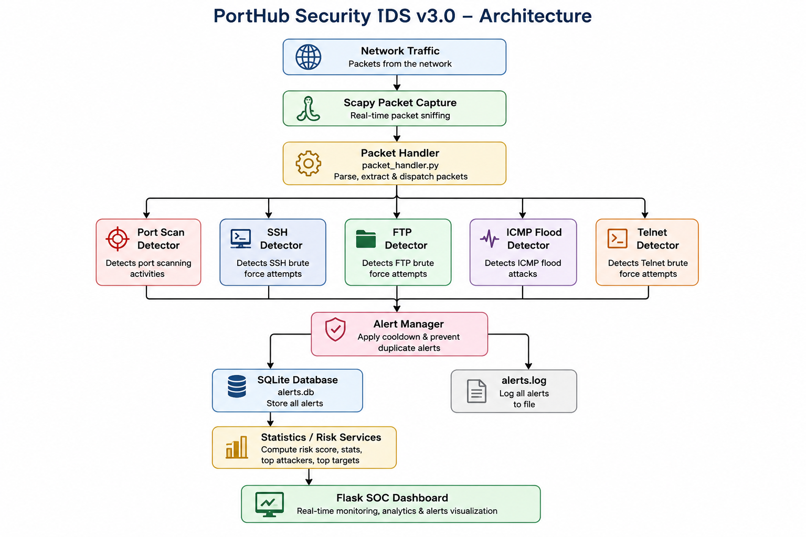
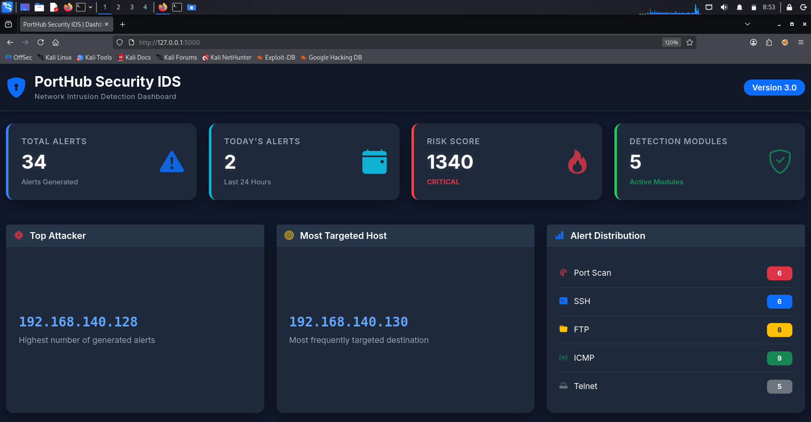
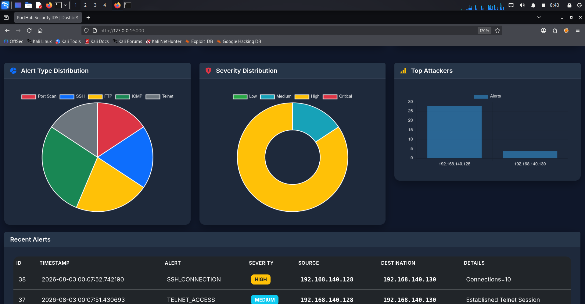
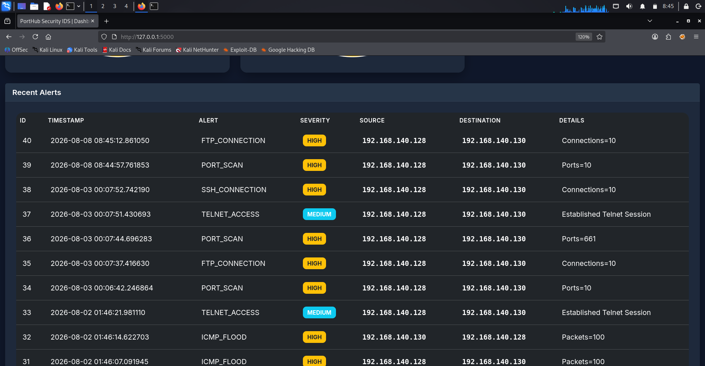
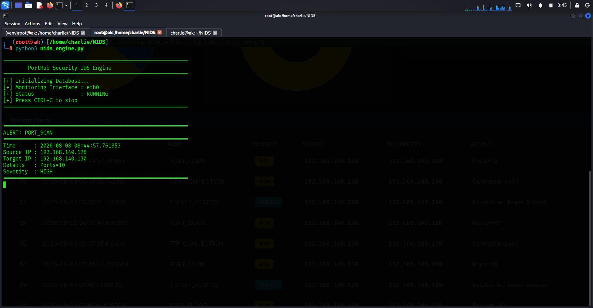

# 🛡️ PortHub Security IDS

> A Python-based Network Intrusion Detection System (NIDS) for real-time network traffic monitoring, attack detection, alert management, risk analysis, and SOC-style security visualization.


---

## 📌 Overview

**PortHub Security IDS** is a lightweight Network Intrusion Detection System developed using Python and Scapy.

The system captures live network traffic, analyzes packets through modular detection engines, generates security alerts, stores events in an SQLite database, calculates a risk score, and presents the collected security information through a Flask-based SOC dashboard.

The project was developed as a practical cybersecurity portfolio project to demonstrate concepts related to:

- Network Security
- Intrusion Detection
- Packet Analysis
- Security Monitoring
- SOC Operations
- Python Security Automation
- Log Analysis
- Security Alert Management

---

# 🎯 Project Objectives

The primary objectives of PortHub Security IDS are:

- Monitor network traffic in real time.
- Detect suspicious network activity.
- Identify common network attack patterns.
- Generate structured security alerts.
- Prevent excessive duplicate alerts using cooldown control.
- Store security events in a persistent database.
- Calculate an overall risk score.
- Provide security analytics through a web dashboard.
- Demonstrate a modular and maintainable NIDS architecture.

---

# ✨ Features

### 🔍 Network Monitoring

- Real-time packet capture using Scapy.
- Configurable network interface.
- Packet inspection and classification.
- Modular packet processing.

### 🚨 Detection Modules

PortHub Security currently includes five validated detection modules:

| Detection Module | Description |
|---|---|
| Port Scan | Detects repeated connection attempts across multiple ports |
| SSH Monitor | Detects repeated SSH connection attempts |
| FTP Monitor | Detects repeated FTP connection attempts |
| ICMP Flood | Detects excessive ICMP traffic within a defined time window |
| Telnet Monitor | Detects established Telnet access |

### 🛡️ Alert Management

- Centralized alert generation.
- Alert severity classification.
- Alert cooldown mechanism.
- Duplicate alert suppression.
- Console alert output.
- File-based alert logging.
- SQLite alert storage.

### 📊 Security Dashboard

The Flask dashboard provides:

- Total alerts
- Today's alerts
- Risk score
- Detection module count
- Top attacker
- Most targeted host
- Alert distribution
- Severity distribution
- Top attackers
- Recent security alerts
- Interactive charts

---

# 🏗️ Architecture

PortHub Security IDS follows a modular architecture where network packets are captured, processed, analyzed by detection modules, passed through centralized alert management, stored, and finally presented through the security dashboard.



### Architecture Flow

```text
Network Traffic
       │
       ▼
Scapy Packet Capture
       │
       ▼
Packet Handler
       │
 ┌─────┼─────┬─────┬─────┐
 ▼     ▼     ▼     ▼     ▼
Port  SSH   FTP   ICMP  Telnet
Scan Monitor Monitor Flood Monitor
       │
       ▼
Alert Manager
       │
 ┌─────┴─────────┐
 ▼               ▼
SQLite        alerts.log
Database
       │
       ▼
Statistics / Risk Services
       │
       ▼
Flask SOC Dashboard
```

---

# 📊 Dashboard

The PortHub Security dashboard provides a centralized SOC-style interface for monitoring detected security events.

## Dashboard Overview



## Security Analytics



## Recent Alerts



## Detection Result



---

# 🧠 Detection Logic

## 1. Port Scan Detection

The Port Scan detector tracks destination ports contacted by a source IP within a configured time window.

If the number of unique ports reaches the configured threshold, a `PORT_SCAN` alert is generated.

Configuration:

```python
PORT_SCAN_THRESHOLD = 10
PORT_SCAN_WINDOW = 30
```

---

## 2. SSH Monitoring

The SSH detector monitors TCP connection attempts to port `22`.

Repeated connection attempts from the same source to the same destination within the configured time window can generate an SSH security alert.

Configuration:

```python
SSH_THRESHOLD = 10
SSH_WINDOW = 60
```

---

## 3. FTP Monitoring

The FTP detector monitors TCP connection attempts to port `21`.

Repeated FTP connection attempts are tracked using a time-based threshold.

Configuration:

```python
FTP_THRESHOLD = 10
FTP_WINDOW = 60
```

---

## 4. ICMP Flood Detection

The ICMP detector monitors ICMP traffic and tracks packet frequency within a configured time window.

Configuration:

```python
ICMP_THRESHOLD = 100
ICMP_WINDOW = 10
```

---

## 5. Telnet Monitoring

The Telnet detector monitors traffic directed to TCP port `23`.

The detector ignores simple SYN packets and requires actual TCP payload data before generating a Telnet access alert.

---

# ⚠️ Risk Scoring

PortHub Security includes a simple risk scoring engine.

Each detected event contributes a weighted value to the overall risk score.

| Detection | Risk Weight |
|---|---:|
| Port Scan | 30 |
| SSH | 50 |
| FTP | 50 |
| ICMP Flood | 40 |
| Telnet | 20 |

The dashboard classifies the resulting risk score as:

| Risk Score | Status |
|---:|---|
| `< 50` | MEDIUM |
| `50 – 99` | HIGH |
| `≥ 100` | CRITICAL |

The risk engine is intended as a lightweight security prioritization mechanism rather than a replacement for a production enterprise risk model.

---

# 🗄️ Alert Storage

Security alerts are stored in two locations.

### SQLite Database

```text
alerts.db
```

The database stores:

- Alert ID
- Timestamp
- Alert type
- Source IP
- Destination IP
- Severity
- Alert details

### Log File

```text
alerts.log
```

The log file provides a human-readable record of generated security alerts.

> Runtime database and log files are excluded from the GitHub repository through `.gitignore`.

---

# 🧩 Project Structure

```text
PortHub-Security-IDS/
│
├── app.py
├── config.py
├── nids_engine.py
├── requirements.txt
├── README.md
├── LICENSE
│
├── core/
│   ├── __init__.py
│   ├── alert_manager.py
│   ├── database.py
│   ├── logger.py
│   ├── packet_handler.py
│   ├── risk_engine.py
│   └── tracker.py
│
├── dashboard/
│   ├── __init__.py
│   ├── routes.py
│   └── statistics.py
│
├── detectors/
│   ├── __init__.py
│   ├── ftp_monitor.py
│   ├── icmp_flood.py
│   ├── port_scan.py
│   ├── ssh_monitor.py
│   └── telnet_monitor.py
│
├── services/
│   ├── __init__.py
│   ├── risk_service.py
│   └── statistics_service.py
│
├── static/
│   ├── css/
│   │   └── dashboard.css
│   │
│   └── js/
│       ├── charts.js
│       ├── dashboard.js
│       └── refresh.js
│
├── templates/
│   └── dashboard.html
│
├── screenshots/
│   ├── dashboard-overview.png
│   ├── detection-result.png
│   ├── recent-alerts.png
│   └── security-analytics.png
│
├── docs/
│   └── architecture.png
│
└── tests/
```

---

# 🛠️ Technologies Used

| Technology | Purpose |
|---|---|
| Python 3 | Core programming language |
| Scapy | Packet capture and network analysis |
| Flask | Web dashboard |
| SQLite | Alert database |
| HTML5 | Dashboard structure |
| CSS3 | Dashboard styling |
| JavaScript | Dashboard functionality |
| Bootstrap 5 | Responsive UI |
| Chart.js | Security analytics |
| Linux/Kali | Development and testing environment |

---

# 📦 Requirements

The project currently uses:

```text
Flask==3.1.3
Scapy==2.7.0
```

along with Flask's required dependencies.

Complete dependency versions are available in:

```text
requirements.txt
```

---

# 🚀 Installation

## 1. Clone the Repository

```bash
git clone https://github.com/abhikarthikav/PortHub-Security-IDS.git
cd PortHub-Security-IDS
```

## 2. Create a Virtual Environment

```bash
python3 -m venv venv
```

## 3. Activate the Virtual Environment

Linux / Kali Linux:

```bash
source venv/bin/activate
```

## 4. Install Dependencies

```bash
pip install -r requirements.txt
```

---

# ⚙️ Configuration

Network and detection parameters can be configured in:

```text
config.py
```

Example:

```python
INTERFACE = "eth0"

PORT_SCAN_THRESHOLD = 10
PORT_SCAN_WINDOW = 30

SSH_THRESHOLD = 10
SSH_WINDOW = 60

FTP_THRESHOLD = 10
FTP_WINDOW = 60

ICMP_THRESHOLD = 100
ICMP_WINDOW = 10

ALERT_COOLDOWN = 60
```

Change the network interface according to your environment.

For example:

```bash
ip addr
```

---

# ▶️ Running the IDS

Because packet capture may require elevated privileges, start the IDS engine with appropriate permissions:

```bash
sudo python3 nids_engine.py
```

The IDS will begin monitoring the configured network interface.

---

# 🌐 Running the Dashboard

Activate the virtual environment:

```bash
source venv/bin/activate
```

Start Flask:

```bash
python3 app.py
```

The dashboard will be available at:

```text
http://127.0.0.1:5000
```

Open the address in a web browser.

> The Flask dashboard itself does not require `sudo`.

---

# 🧪 Testing

The detection modules were tested in an isolated virtualized lab environment.

The test environment included:

- Kali Linux
- Metasploitable2
- VMware virtualization
- Nmap
- SSH
- FTP
- Telnet
- ICMP traffic generation

## Detection Test Results

| Test | Result |
|---|---|
| Nmap Port Scan | ✅ Detected |
| SSH Connection Attempts | ✅ Detected |
| FTP Connection Attempts | ✅ Detected |
| ICMP Flood | ✅ Detected |
| Telnet Access | ✅ Detected |
| Alert Database Storage | ✅ Verified |
| Alert Log Storage | ✅ Verified |
| Risk Score Updates | ✅ Verified |
| Dashboard Statistics | ✅ Verified |
| Alert Type Chart | ✅ Verified |
| Severity Chart | ✅ Verified |
| Top Attackers Chart | ✅ Verified |

---

# 🔬 Validation Examples

### Port Scan

Example:

```bash
nmap -sS <TARGET-IP>
```

The IDS detects repeated port activity and generates a port scan alert when the configured threshold is reached.

### SSH Monitoring

Repeated SSH connection attempts can be generated in the isolated test environment to validate the SSH detector.

### FTP Monitoring

FTP connection attempts against the test machine were used to validate FTP monitoring.

### ICMP Flood

High-volume ICMP traffic was generated in the isolated lab environment to validate ICMP flood detection.

### Telnet Monitoring

A Telnet session was used to verify detection of established Telnet access.

---

# 🛡️ Alert Management

PortHub Security uses a centralized alert manager to control duplicate alerts.

The alert cooldown mechanism prevents the same source/destination detection key from repeatedly generating identical alerts within the configured cooldown period.

Configuration:

```python
ALERT_COOLDOWN = 60
```

This helps reduce alert noise and makes the dashboard easier to analyze.

---

# 📈 Security Analytics

The dashboard provides three primary visual analytics:

### Alert Type Distribution

Displays the distribution of:

- Port Scan
- SSH
- FTP
- ICMP
- Telnet

### Severity Distribution

Displays:

- LOW
- MEDIUM
- HIGH
- CRITICAL

### Top Attackers

Displays source IP addresses responsible for the highest number of generated alerts.

---

# 🔐 Security Considerations

PortHub Security IDS is intended for:

- Cybersecurity education
- Security research
- Isolated lab environments
- Portfolio demonstration
- NIDS development practice

Testing should only be performed on systems and networks where you have explicit authorization.

The project should not be deployed directly as a production enterprise IDS without additional security hardening, performance testing, authentication, secure configuration management, and extensive validation.

---

# ⚠️ Current Limitations

The current implementation is intentionally lightweight.

Known limitations include:

- Detection is threshold-based.
- Detection rules are not yet adaptive.
- Risk scoring is rule-based.
- The dashboard currently uses Flask server-side rendering.
- No user authentication is implemented.
- No centralized SIEM integration is implemented.
- No distributed sensor architecture is implemented.
- High-volume production traffic would require further performance optimization.
- Detection accuracy depends on configured thresholds.

---

# 🔮 Future Improvements

Potential future development includes:

- Authentication and role-based access control
- REST API
- Email and notification integration
- SIEM integration
- Syslog support
- Additional protocol detectors
- Advanced anomaly detection
- Machine-learning-assisted detection
- PCAP investigation support
- PDF/CSV alert reports
- Distributed NIDS sensors
- Improved event correlation
- Production-scale performance optimization

---

# 📚 Learning Outcomes

This project provided practical experience in:

- Network packet analysis
- TCP/IP traffic inspection
- Python security programming
- Scapy
- Intrusion detection concepts
- Security alert generation
- SQLite database management
- Flask application development
- Dashboard development
- Risk scoring
- Log management
- Modular software architecture
- Linux security tooling
- Security testing in virtualized environments

---

# 👨‍💻 Author

## Abhi Karthik

Cybersecurity Enthusiast | Network Security | SOC | Python | Ethical Hacking

Advanced Diploma in Information Security (ADIS)

Kerala, India

### GitHub

```text
https://github.com/abhikarthikav
```

### LinkedIn

```text
https://www.linkedin.com/in/abhikarthikav/
```

---

# 📜 License

This project is licensed under the MIT License.

See the `LICENSE` file for details.

---

# ⭐ Support

If you find this project useful for learning or cybersecurity research, consider giving the repository a ⭐ on GitHub.

---

## PortHub Security IDS v3.0

```text
Network Intrusion Detection System
Real-Time Monitoring • Detection • Alerting • Analytics
```
