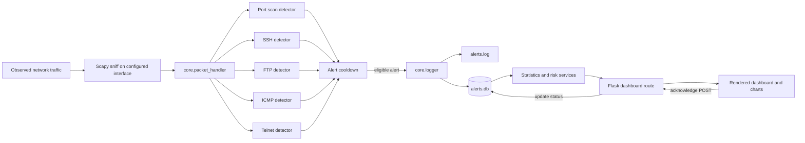

# PortHub Security IDS

PortHub Security IDS is a small, Python-based network intrusion detection system (NIDS). It captures packets on one configured interface with Scapy, applies five threshold-based detectors, records generated alerts to SQLite and a text log, and presents stored events in a Flask dashboard.

It is an educational defensive-monitoring project, not a firewall or a production security platform. It observes and reports; it does not block traffic.

## Contents

- [Overview](#overview)
- [Features](#features)
- [Detection behavior](#detection-behavior)
- [Technology stack](#technology-stack)
- [Architecture](#architecture)
- [Repository layout](#repository-layout)
- [Prerequisites and platforms](#prerequisites-and-platforms)
- [Installation](#installation)
- [Packet-capture requirements](#packet-capture-requirements)
- [Network interface](#network-interface)
- [Database and logs](#database-and-logs)
- [Run the application](#run-the-application)
- [Dashboard guide](#dashboard-guide)
- [Configuration reference](#configuration-reference)
- [Safe validation](#safe-validation)
- [Troubleshooting](#troubleshooting)
- [Security considerations and limitations](#security-considerations-and-limitations)
- [Testing and verification](#testing-and-verification)
- [Screenshots](#screenshots)
- [Roadmap](#roadmap)
- [Contributing](#contributing)
- [License](#license)
- [Disclaimer](#disclaimer)

## Overview

Network intrusion detection looks for traffic patterns that may indicate unwanted or abnormal activity. PortHub provides a compact example of that workflow: capture packets, dispatch IP packets to protocol-specific checks, apply thresholds and an alert cooldown, store matching events, and review them in a web dashboard.

The current implementation checks TCP SYN activity for port scans and repeated SSH/FTP connection attempts, counts ICMP packets, and looks for TCP payload directed to Telnet. These are simple rules. They do not establish intent, identify every attack, or guarantee that suspicious activity will be detected.

## Features

- Live packet capture through Scapy's `sniff()` on one interface selected in `config.py`.
- Five packet detectors for TCP port scans, SSH, FTP, ICMP volume, and Telnet payload traffic.
- Central alert handling with severity values and a process-local cooldown.
- Console output, append-only `alerts.log`, and SQLite persistence for generated alerts.
- Flask dashboard with alert counters, risk score/status, top source and destination, alert-type distribution, severity distribution, and top attackers.
- Browser-side alert search and severity/type filters.
- Browser-side CSV export of currently visible alert rows and a separate server route that exports all stored alerts.
- Alert acknowledgment from the dashboard.

No machine-learning or AI detection is implemented.

## Detection behavior

The packet handler ignores packets without an IPv4 `IP` layer. Each accepted packet is passed to all five detector functions; each detector returns early when its protocol/port criteria do not match.

| Detector | Implemented rule | Alert type / severity | Default settings |
| --- | --- | --- | --- |
| Port scan | Counts unique destination TCP ports for each source/destination pair when `TCP.flags` is exactly `"S"`. An alert is eligible after the set reaches the configured size. There is no time-window pruning for this set. | `PORT_SCAN` / `HIGH` | `PORT_SCAN_THRESHOLD = 10` |
| SSH | Counts TCP packets to destination port 22 with flags exactly `"S"`, retaining attempts inside a rolling time window per source/destination pair. | `SSH_CONNECTION` / `HIGH` | `SSH_THRESHOLD = 10`, `SSH_WINDOW = 60` seconds |
| FTP | Counts TCP SYN attempts to destination port 21 in a rolling time window per source/destination pair. | `FTP_CONNECTION` / `HIGH` | `FTP_THRESHOLD = 10`, `FTP_WINDOW = 60` seconds |
| ICMP | Counts ICMP packets inside a rolling time window per source/destination pair. It does not restrict the check to echo requests. | `ICMP_FLOOD` / `HIGH` | `ICMP_THRESHOLD = 100`, `ICMP_WINDOW = 10` seconds |
| Telnet | Checks TCP destination port 23, ignores packets whose flags are exactly `"S"`, and requires a non-empty TCP payload. | `TELNET_ACCESS` / `MEDIUM` | No detector threshold or window; cooldown applies |

All detectors call the shared alert manager before logging. The cooldown is keyed by detector, source, and destination, and its default is 60 seconds. It suppresses repeated alerts for a key during that interval; it does not clear the detector's tracking state. Tracker and cooldown data are held in process memory and are lost when the engine exits.

These rules inspect individual captured packets. The code does not reassemble TCP streams, authenticate SSH/FTP users, infer successful logins, correlate flows, or use an adaptive baseline. The SSH and FTP names therefore describe connection-attempt thresholds, not verified brute-force logins.

## Technology stack

| Component | Use in this project |
| --- | --- |
| Python | Packet processing, detector logic, alert handling, and web application |
| Scapy 2.7.0 | Packet capture and packet-layer inspection |
| Flask 3.1.3 | Server-rendered dashboard and HTTP routes |
| SQLite (`sqlite3`) | Local alert storage; part of Python's standard library |
| Jinja2 | Dashboard template rendering; installed with Flask |
| Bootstrap 5.3.3 | Dashboard layout and UI styles, loaded from a CDN |
| Bootstrap Icons 1.11.3 | Dashboard icons, loaded from a CDN |
| Chart.js | Dashboard charts, loaded from an unpinned jsDelivr URL |
| Inter | Dashboard font, loaded from Google Fonts |

The frontend CDN assets require browser network access. Python package versions are pinned in [`requirements.txt`](requirements.txt); there is no frontend package manifest.

## Architecture

`nids_engine.py` initializes the database and starts a blocking Scapy capture on `config.INTERFACE`. The callback in `core.packet_handler` dispatches IPv4 packets to the detectors. A detector that crosses its rule threshold asks `core.alert_manager` whether its key is outside the cooldown. If allowed, `core.logger` prints the alert and appends it to the log and database.

The Flask app is a separate process. Its dashboard route reads the same SQLite database, calculates statistics and risk, and renders `templates/dashboard.html`. Acknowledgments are written back to the database through a POST route.



The capture process and Flask web process are started separately. The dashboard does not start packet capture, and packet capture does not require the dashboard to be running.

## Repository layout

```text
PortHub-Security-IDS/
├── app.py                         # Flask application entry point
├── config.py                      # Interface, storage, thresholds, and severities
├── nids_engine.py                 # Database initialization and packet-capture entry point
├── requirements.txt               # Pinned Python dependencies
├── README.md
├── .gitignore
├── alerts.db                      # Local SQLite runtime data (ignored by Git)
├── alerts.log                     # Local alert log (ignored by Git)
├── core/
│   ├── __init__.py
│   ├── alert_manager.py           # Per-key alert cooldown
│   ├── database.py                # SQLite schema and queries
│   ├── logger.py                  # Console, file, and database alert writing
│   ├── packet_handler.py          # Dispatches captured IP packets
│   ├── risk_engine.py             # Empty module; current risk calculation is in a service
│   └── tracker.py                 # In-memory detector and cooldown state
├── dashboard/
│   ├── __init__.py
│   ├── routes.py                  # Dashboard, full CSV export, acknowledgment routes
│   └── statistics.py              # Statistics helper module
├── detectors/
│   ├── __init__.py
│   ├── ftp_monitor.py
│   ├── icmp_flood.py
│   ├── port_scan.py
│   ├── ssh_monitor.py
│   └── telnet_monitor.py
├── services/
│   ├── __init__.py
│   ├── risk_service.py            # Weighted risk score and status
│   └── statistics_service.py      # Dashboard and chart aggregations
├── static/
│   ├── css/dashboard.css
│   └── js/
│       ├── charts.js
│       ├── dashboard.js
│       └── refresh.js
└── templates/
    └── dashboard.html
```

The current checkout has no automated test directory, CI workflow, `LICENSE` file, `docs/` directory, or screenshot files. The shown `alerts.db` and `alerts.log` are local runtime artifacts and are ignored by Git along with other database and log files.

## Prerequisites and platforms

- Python 3.9 or newer is needed for the pinned Flask 3.1.3 dependency. The repository does not declare a tested Python version matrix.
- Git is needed to clone the project.
- Packet capture requires a supported capture interface and operating-system permissions. Windows requires Npcap for Scapy capture. Linux commonly uses native packet sockets; capture typically requires elevated privileges or suitable capabilities. Scapy also documents native capture on macOS, with libpcap available when needed.
- A browser is needed for the dashboard. Bootstrap, Bootstrap Icons, Chart.js, and the font are loaded from external CDNs.

Scapy supports multiple operating systems, but this repository contains no platform-specific test matrix. Interface names, privileges, drivers, and capture behavior vary by host. The configured default `INTERFACE = "WiFi"` must be checked and changed for your system.

## Installation

Clone the configured repository remote and enter the project directory:

```bash
git clone https://github.com/arsalaniqbal2024/PortHub-Security-IDS.git
cd PortHub-Security-IDS
```

Create and activate a virtual environment.

**Windows PowerShell:**

```powershell
py -3 -m venv .venv
.\.venv\Scripts\Activate.ps1
```

**Linux or macOS:**

```bash
python3 -m venv .venv
source .venv/bin/activate
```

Install the pinned dependencies:

```bash
python -m pip install --upgrade pip
python -m pip install -r requirements.txt
```

Run application commands from the repository root. `DATABASE_NAME` and `ALERT_LOG_FILE` are relative paths, so the working directory determines where `alerts.db` and `alerts.log` are created.

## Packet-capture requirements

Scapy must be able to open the selected capture interface.

- **Windows:** Install Npcap using its official [installation instructions](https://npcap.com/). Run the capture engine from a terminal with the permissions required by the installed Npcap configuration.
- **Linux:** Scapy can use native packet sockets. Running the engine may require `sudo` or separately configured capture capabilities. Avoid granting broad privileges to the web application.
- **macOS:** Scapy documents native capture support; capture permissions and available interfaces depend on the macOS configuration. Install/use libpcap if the selected capture backend requires it.

The project does not configure `conf.use_pcap`, a BPF capture filter, or a particular capture backend. `nids_engine.py` calls `sniff(iface=INTERFACE, prn=process_packet, store=False)` and receives packets visible on that interface. A missing interface, unsupported adapter/driver, permission error, or blocked capture backend will prevent capture startup or cause packets to be missed.

## Network interface

The engine reads `INTERFACE` from `config.py`; its current value is `"WiFi"`. Scapy must recognize the exact name supplied to `sniff()`.

Use the installed Scapy interface list to inspect names:

**Windows PowerShell:**

```powershell
python -c "from scapy.all import get_if_list; print(*get_if_list(), sep='\n')"
```

**Linux or macOS:**

```bash
python -c 'from scapy.all import get_if_list; print("\n".join(get_if_list()))'
```

You can compare these with the operating system's adapter list (for example, `Get-NetAdapter` in PowerShell or `ip link` on Linux), then set the exact Scapy interface name in `config.py`. Interface names shown by the operating system and Scapy may differ. Restart the capture engine after changing the setting.

## Database and logs

`core.database` uses Python's SQLite library and the configured `DATABASE_NAME`, currently `alerts.db`. Its `initialize()` method creates the `alerts` table if absent and adds a `status` column with default `NEW` when migrating an older table without that column. The engine calls `database.initialize()` before starting capture.

The Flask route does **not** initialize the schema. To create or migrate the database without starting packet capture, run this from the project root with the virtual environment active:

```bash
python -c "from core.database import database; database.initialize()"
```

The alert table stores an auto-incrementing ID, timestamp, alert type, source IP, destination IP, severity, details, and status. New alerts receive the database default status `NEW`; dashboard acknowledgment updates it to `ACKNOWLEDGED`. Records are ordered newest-first by ID in the dashboard query. There is no built-in retention or rotation policy.

`core.logger` appends human-readable events to `ALERT_LOG_FILE`, currently `alerts.log`, and inserts the same generated alert into SQLite. Both file paths are relative to the process working directory. `.gitignore` excludes `*.db`, `*.sqlite3`, and `*.log` files.

## Run the application

Initialize the database first as shown above if it does not already exist.

### Start the detector

Open a terminal at the repository root with the virtual environment activated. Start the engine with the privileges required by your capture backend:

**Windows:** In a terminal with the required Npcap permissions:

```powershell
python nids_engine.py
```

**Linux or macOS:** If capture permissions require elevation, use the virtual-environment interpreter:

```bash
sudo .venv/bin/python nids_engine.py
```

The engine prints its configured interface and then blocks in Scapy capture until interrupted (usually with `Ctrl+C`). Do not run elevated commands unless you understand the privilege implications.

### Start the dashboard

In a second terminal, from the project root with dependencies installed:

```bash
python app.py
```

The current `app.py` calls `app.run(debug=True)`, which starts Flask's development server. Open [http://127.0.0.1:5000/](http://127.0.0.1:5000/) on the same host. Do not expose this debug server to an untrusted network or use it as a production server.

The engine and dashboard use the same relative SQLite path. Start them from the same project root so they read and write the same database.

## Dashboard guide

The `/` route calculates values from stored alerts and renders `templates/dashboard.html`.

| Dashboard element | Source/behavior |
| --- | --- |
| Total alerts | Count of all rows in `alerts` |
| Today's alerts | SQLite `DATE(timestamp) = DATE('now')`; this is a calendar-date comparison using SQLite's current-time behavior, not a rolling 24-hour query despite the existing UI caption |
| New and acknowledged | Counts where status equals `NEW` or `ACKNOWLEDGED` |
| Risk score/status | Weighted sum of alert-type counts, described below |
| Detection modules | The template displays a fixed value of `5` |
| Top attacker/target | Source/destination IP with the most alert rows |
| Alert distribution | Counts for port scan, SSH, FTP, ICMP, and Telnet alerts |
| Charts | Alert-type pie, severity doughnut, and top-attacker bar charts using data embedded by the route |
| Recent alerts | Database rows with severity/status badges, source/destination, details, and acknowledgment action |
| Top attackers table | Up to five source IPs ordered by alert count |

The risk service assigns weights of 30 to port scans, 50 to SSH, 50 to FTP, 40 to ICMP, and 20 to Telnet. It returns `MEDIUM` below 50, `HIGH` from 50 through 99, and `CRITICAL` at 100 or above. This is a simple alert-count score, not an enterprise risk model. `LOW` exists as a configuration string but the current detectors do not emit it.

Search matches the rendered row text. Severity and type filters use the alert and severity cells in the table. Browser-side CSV export includes the table header and currently visible nine-cell alert rows (including the Action cell text), and names the download based on whether filters are active. Separately, `GET /export-alerts` exports all stored rows with eight database fields; it does not apply browser filters.

Selecting **Acknowledge** submits `POST /acknowledge-alert/<alert_id>`, updates the row status, and redirects to `/`. There is no authentication or CSRF protection on this route. The `refresh.js` file currently contains only a comment saying automatic refresh is disabled. `DASHBOARD_REFRESH` is defined in `config.py` but is not used by the page scripts.

## Configuration reference

All current settings are in `config.py`:

| Setting | Default | Meaning / code usage |
| --- | --- | --- |
| `INTERFACE` | `"WiFi"` | Interface passed to Scapy's `sniff()` |
| `DATABASE_NAME` | `"alerts.db"` | Relative SQLite database filename |
| `ALERT_LOG_FILE` | `"alerts.log"` | Relative append-only alert log filename |
| `PORT_SCAN_THRESHOLD` | `10` | Number of unique destination ports per source/destination pair before a port-scan alert is eligible |
| `PORT_SCAN_WINDOW` | `30` | Defined in configuration but not read by the current port-scan detector |
| `SSH_THRESHOLD` | `10` | SSH SYN attempts required within `SSH_WINDOW` |
| `SSH_WINDOW` | `60` seconds | Rolling SSH attempt window |
| `FTP_THRESHOLD` | `10` | FTP SYN attempts required within `FTP_WINDOW` |
| `FTP_WINDOW` | `60` seconds | Rolling FTP attempt window |
| `ICMP_THRESHOLD` | `100` | ICMP packets required within `ICMP_WINDOW` |
| `ICMP_WINDOW` | `10` seconds | Rolling ICMP packet window |
| `ALERT_COOLDOWN` | `60` seconds | Minimum time between alerts for the same in-memory key |
| `DASHBOARD_REFRESH` | `5` seconds | Defined but unused; automatic page refresh is disabled |
| `LOW` | `"LOW"` | Severity label; no current detector emits it |
| `MEDIUM` | `"MEDIUM"` | Used by the Telnet detector |
| `HIGH` | `"HIGH"` | Used by the other four detectors |
| `CRITICAL` | `"CRITICAL"` | Used by the risk status calculation, not emitted as an alert severity by the detectors |

Edit these values in `config.py` and restart the relevant process. The port-scan detector currently does not use `PORT_SCAN_WINDOW`; changing it has no effect.

## Safe validation

Validate only on systems and networks that you own or are explicitly authorized to monitor. A suitable setup is an isolated host-only virtual network with a sensor VM and one or more test VMs, no bridged access to networks outside the lab, and a capture interface selected explicitly in `config.py`.

1. Install the capture prerequisites and confirm the selected interface with Scapy.
2. Initialize the database, start `nids_engine.py`, and start `app.py` in separate terminals.
3. Generate ordinary, controlled test traffic between lab systems you administer. For threshold behavior, keep the activity limited to those lab hosts and document the configured thresholds before testing.
4. Confirm that generated alerts appear in the console, `alerts.log`, SQLite, and the dashboard; verify filtering, export, and acknowledgment on those records.
5. Stop the engine with `Ctrl+C` and review the test log/database before cleanup.

Do not run scans, connection bursts, or high-volume traffic against public, shared, or third-party networks. This project has no built-in traffic generator or automated detector test suite.

## Troubleshooting

| Symptom | Checks |
| --- | --- |
| `sniff()` reports an interface error | Confirm `INTERFACE` exactly matches a name returned by Scapy; verify the adapter is enabled and supported; restart after editing `config.py`. |
| Capture permission/access denied | Install Npcap on Windows and use the permissions required by its configuration. On Linux/macOS, check capture-device permissions or run only the capture process with appropriate privileges. |
| Engine starts but no alerts appear | Confirm packets are visible on the selected interface, include an IPv4 `IP` layer, and match the detector's exact protocol/port/flag/payload conditions. Confirm thresholds and windows in `config.py`. |
| Dashboard reports a missing table/database error | Run `python -c "from core.database import database; database.initialize()"` from the project root before starting Flask. |
| Dashboard counters remain zero | The dashboard reads stored alerts; it does not capture traffic itself. Ensure the engine and dashboard use the same working directory/database and inspect `alerts.log` and the engine console. |
| Browser shows missing styles, icons, font, or charts | The template loads these assets from external CDNs; check browser internet access and developer-console network errors. |
| `python app.py` cannot import a dependency | Activate the project's virtual environment and run `python -m pip install -r requirements.txt` with the same interpreter. |
| Interface names differ between OS and Scapy | Use `get_if_list()` from the installed Scapy package and set the returned interface name in `config.py`. |
| Dashboard does not update after an event | Reload the page manually. `refresh.js` is intentionally inactive and no automatic refresh behavior is implemented. |

## Security considerations and limitations

- This is a passive IDS prototype; it does not prevent, block, or remediate traffic.
- Threshold rules can produce false positives and false negatives. They inspect packets, not authenticated sessions or complete TCP conversations.
- The port-scan set is not time-pruned and can accumulate distinct ports for a source/destination pair for the lifetime of the engine process. In-memory tracker state and cooldowns reset on restart.
- Scapy capture performance and packet visibility depend on host, driver, interface, privileges, and traffic volume. The engine does not apply a BPF filter or define a production capacity target.
- SQLite and log files use relative paths. There is no retention, rotation, encryption, or multi-process coordination policy documented by the application.
- The dashboard has no user authentication, authorization, TLS configuration, or CSRF protection. The Flask development server runs with debug enabled. Keep it bound to a trusted local development environment; do not publish it as-is.
- The dashboard's filtered CSV is generated in the browser from visible table cells. The server-side `/export-alerts` route returns all stored records and has no authentication.
- CDN-loaded assets require browser internet access and are not vendored or pinned to local files.
- No license file, automated tests, CI configuration, or maintained platform support matrix is present in the current repository tree.

Do not treat the risk score or detector output as a complete security assessment. Use established monitoring and incident-response controls for real environments.

## Testing and verification

No automated test suite is included in the current repository. The following checks use standard tools and do not generate network traffic:

```bash
python -m compileall -q app.py config.py nids_engine.py core dashboard detectors services
```

If Node.js is available, the browser scripts can be syntax-checked (this does not test them in a browser):

```bash
node --check static/js/dashboard.js
node --check static/js/charts.js
```

For an application smoke check, initialize the database, run `python app.py`, and open `http://127.0.0.1:5000/`. Capture functionality must be checked separately on an authorized lab interface with the platform's capture prerequisites installed.

## Screenshots

Screenshots are not currently present in the repository. Replace these placeholders with real, current images before publishing if screenshots are desired:

- **Dashboard overview:** _Screenshot placeholder; no image file is currently available._
- **Threat analytics:** _Screenshot placeholder; no image file is currently available._
- **Recent alerts and filters:** _Screenshot placeholder; no image file is currently available._

Avoid including real public IPs, usernames, hostnames, credentials, or other sensitive data in future screenshots.

## Roadmap

The following are possible future improvements and are **not implemented features**:

- Add automated unit tests for database operations, risk calculation, and detector edge cases.
- Add packet-capture integration tests using controlled fixtures or an isolated lab.
- Make port-scan tracking windowed and bound the lifetime/size of in-memory trackers.
- Add configurable interface validation and capture filters.
- Add authentication, authorization, CSRF protection, and a production deployment configuration before any remote exposure.
- Add alert retention/rotation controls and stronger timestamp/time-zone handling.
- Add more protocol detectors, event correlation, or external SIEM integration after validation.
- Add screenshot assets and a platform support/test matrix.

## Contributing

Contributions should be focused and should not include traffic aimed at systems without authorization. Before opening a pull request:

1. Describe the problem and the code paths affected.
2. Keep detector behavior and configuration changes explicit, and document new settings.
3. Validate Python syntax and, where possible, exercise behavior in an isolated lab.
4. Do not include captured traffic, alert databases, logs, secrets, or sensitive IP information in commits.
5. Update this README when actual behavior, setup requirements, or limitations change.

There is no separate contribution guide or automated CI workflow in the repository at this time.

## License

No `LICENSE` file is present in the current repository tree. No license is asserted here; check with the project owner before reusing or redistributing the code.

## Disclaimer

PortHub Security IDS is provided for educational, research, and authorized defensive-monitoring use. Capture and analyze only traffic on systems and networks for which you have explicit permission. You are responsible for complying with applicable laws, organizational policies, and privacy requirements. The software is provided without a guarantee of detection accuracy, availability, or fitness for a particular purpose.